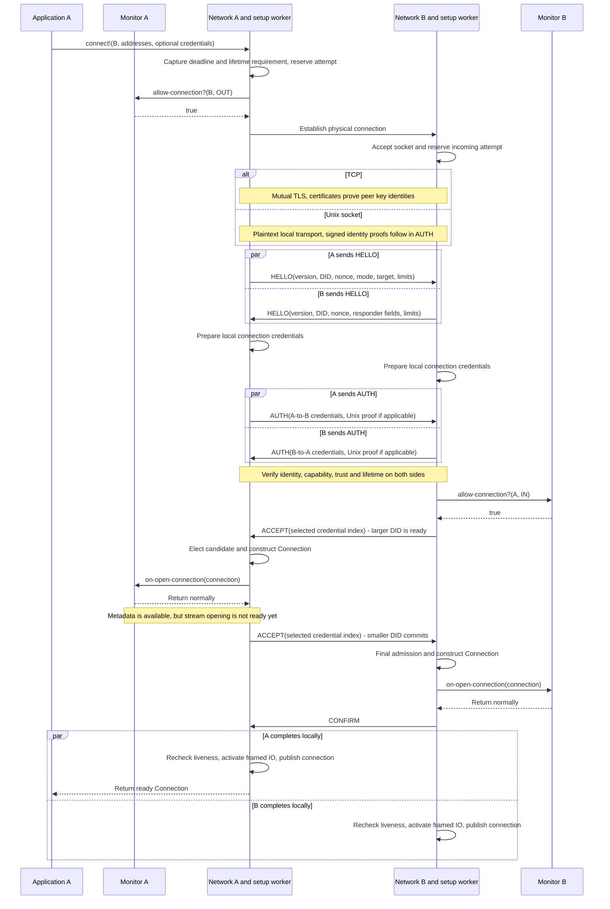
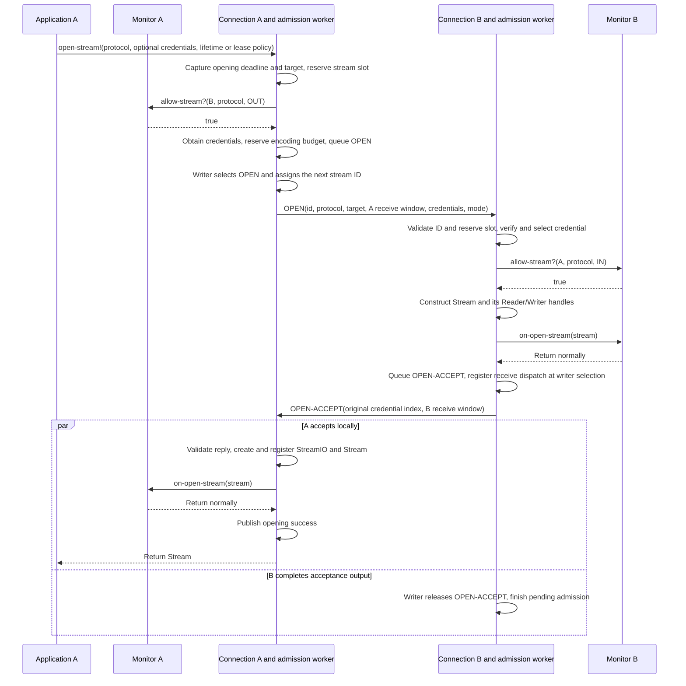
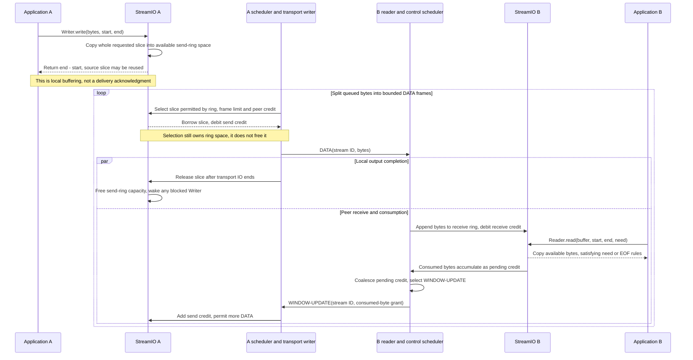
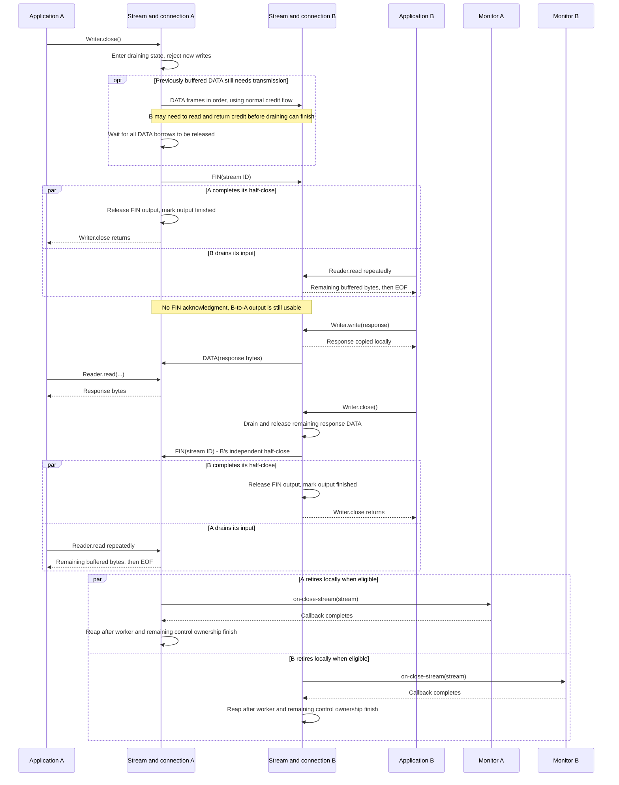

# Network Interaction Diagrams

These diagrams follow one successful connection and stream through their lifecycle.
They complement the [public API overview](../network.md); they are not additional
protocol rules. Mermaid-capable Markdown viewers, including GitHub, render them as
sequence diagrams.
Each section also links to a rendered PNG that can be opened directly in an image
viewer such as Emacs, without a browser or Mermaid support. The Mermaid blocks
remain the editable source; [rendering instructions](diagrams/README.md) describe
how to refresh the images.

- [Opening a connection](#opening-a-connection)
- [Opening a stream](#opening-a-stream)
- [Sending data](#sending-data)
- [Gracefully closing a stream](#gracefully-closing-a-stream)

Time runs downward. `A` and `B` are different hosts; a **DID** identifies a host's
key. Each application supplies a **NetworkMonitor** for admission and lifecycle
notifications. Uppercase messages such as `OPEN` and `DATA` are wire frames;
lowercase method calls are local API calls. Dashed arrows show local returns, not
extra protocol acknowledgments. Parallel blocks show independently progressing
work, not a requirement that both events happen simultaneously.

The connection/endpoint lifelines group several implementation objects and workers
for readability. In reality each established connection has one transport reader,
one transport writer and a service/timer; an opening has its own admission worker.
Callbacks and credential work run outside owner/stream locks. The drawings omit
locks, retries, renewal and most failure paths. They show representative successful
interleavings, not a global synchronization barrier between hosts.

## Opening a Connection

[View rendered PNG](diagrams/opening-connection.png)

Assume B is already listening, there is no reusable connection, and **A dials B
and has the lexicographically smaller canonical DID**. This assumption makes the
asymmetric election easy to see. If the dialer's DID is larger, the physical dial
direction stays the same but the two ACCEPT roles and CONFIRM direction reverse.

Identity and permission are separate: TLS or the Unix proof identifies the key,
while UCAN credentials authorize the connection. Use `proto:/network/connect` when
creating those credentials. The installed connection expiration is the minimum
expiration of the two accepted credentials, not a fresh TTL measured at publication.

The first ACCEPT is readiness, not commitment. The smaller DID coordinates initial
election even if it did not dial. This is distinct from renewal coordination, which
belongs to the original physical initiator.

`on-open-connection` is a final-admission callback, **not a readiness event**. It must
return promptly. If a callback hands the Connection to an application worker, that
worker can use `connect!(peer, [])` to await ready publication before opening a
stream; it must not block the callback itself on that operation.

Existing connections take shorter paths: a covered/default request reuses the live
Connection, and concurrent callers can join an already-pending attempt. Those paths
do not repeat the handshake or open callbacks. Failed authentication/admission may
send REJECT or close the candidate; only normally completed open callbacks earn
matching close notifications.

Details: [handshake](handshake.md), [election and publication](network.md), and
[authentication](auth.md).

## Opening a Stream

[View rendered PNG](diagrams/opening-stream.png)

Either endpoint can open streams once the connection is ready. Here A opens one
protocol stream on an existing connection; no new socket or TLS handshake is needed.
The initial stream credential authorizes **opener-to-recipient** use of the requested
protocol. There is no separate reciprocal credential exchange for response DATA.

The callback ordering is deliberately asymmetric: B's `on-open-stream` precedes
OPEN-ACCEPT output; A's follows validated receipt. B registers receive dispatch at
ACCEPT selection because A can respond before B's local write-release bookkeeping
finishes. B's own DATA still follows OPEN-ACCEPT through the same single writer.
Callbacks should hand IO to application workers rather than wait for it inline.

The advertised windows grant initial credit **toward the advertiser**: A's OPEN
window permits B-to-A DATA; B's OPEN-ACCEPT window permits A-to-B DATA. No separate
initial WINDOW-UPDATE is required. IDs are allocated in actual OPEN output order:
the physical connection initiator uses odd IDs, the responder even IDs.

`Stream.expire` is the selected credential's expiration. In fixed mode the requested
expiration uses the stream TTL/absolute-expiration rules; linked mode captures the
installed connection expiration and later reauthorizes the same stream as needed.
Opening a stream never renews its connection. Refusal before acceptance uses
OPEN-REJECT; cancellation after acceptance can require RESET. Unrelated streams
remain usable unless the failure is connection-fatal.

Details: [stream admission](connection.md#bounded-stream-admission) and
[public stream contracts](interface.md#stream).

## Sending Data

[View rendered PNG](diagrams/sending-data.png)

Two independent limits govern progress: **local send-ring space** and **credit from
the peer**. This example starts with a write small enough to fit the local ring.
A larger call waits and copies successive portions under one deadline, returning
only when its entire requested slice has been copied.

Local output release and the peer's receive/read/update path can interleave. Only
actual transport release frees a borrowed send slice; it does **not** restore peer
credit. Only received WINDOW-UPDATE grants restore send credit. A peer read creates
pending credit, which may be coalesced before its update is selected for output.
Consumption can generate credit even while a large minimum read is still waiting.

There is no per-DATA acknowledgment, and write calls, DATA frames and read calls do
not correspond one-to-one. With no peer credit, DATA scheduling waits; with no local
ring space, application writes wait. Control frames and other eligible streams
continue subject to the shared scheduler's bounded capacity and fairness rules.
The reverse byte direction uses its own rings and credits through the same connection.

Details: [byte IO](interface.md#byte-io), [bounded stream state](stream.md), and
[managed scheduling](connection.md#explicit-managed-progress).

## Gracefully Closing a Stream

[View rendered PNG](diagrams/closing-stream.png)

**Close the Writer to finish sending gracefully.** `Stream.close` and `Reader.close`
are abortive, not shortcuts for this exchange. Below A finishes its request, B reads
through EOF and sends a response, then B independently finishes its output.

`Writer.close` waits for queued DATA and FIN **output completion**, not for the peer
to consume those bytes or send its own FIN. Its original drain deadline still
applies; repeated close joins that drain rather than restarting the deadline.
The peer preserves unread input after FIN. EOF returns zero once no bytes remain
and the requested minimum permits it; asking for more bytes than remain can raise
`PrematureEndOfInput` instead. That expected EOF condition does not abort reverse IO.

Each endpoint becomes gracefully retirable when its own output is finished and its
input has reached fully consumed EOF. The endpoints need not retire together.
Close callbacks and actual slot reclamation are later lifecycle steps, not part of
the peer's acknowledgment of FIN. Actual slot reclamation also waits for any
still-owned renewal work; the close callback can complete before that work is
released. Metadata and the existing Reader/Writer identities remain available
after retirement, but closed directions cannot be used again. The connection itself
can continue carrying other streams.

For an abortive close, unread and unsent bytes are discarded and waiters are woken;
the parent schedules RESET as required by the stream's state. Already borrowed DATA
remains owned until its writer releases it. `Network.close` is broader still: it
closes transport before cleanup and joins owned workers and eligible notifications.
Inline calls from monitor callbacks or any network-owned worker raise
`ContractViolation` before shutdown effects, including cross-network and already
closing calls. Dispatch close to an application thread and let the callback return;
that thread does not inherit the network-worker marker.

Details: [stream half-close semantics](stream.md#public-stream),
[callbacks and retirement](connection.md#callbacks-and-retirement), and
[network shutdown](../network.md#callbacks-and-shutdown).
